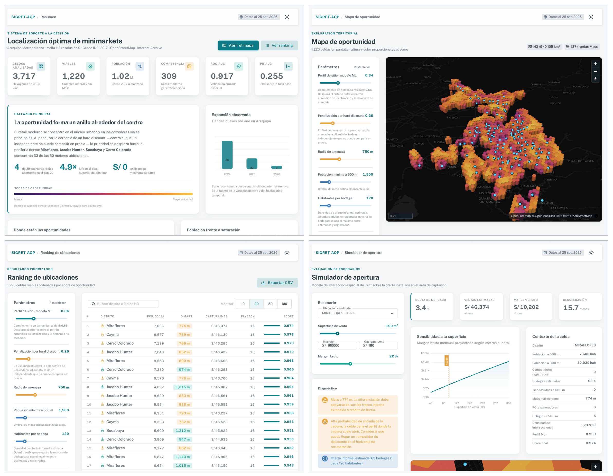

# SIGRET-AQP

**Sistema de soporte a la decisión basado en analítica geoespacial y aprendizaje automático para la localización de minimarkets independientes en Arequipa Metropolitana**

Tesis de Ingeniería de Sistemas · Universidad Católica de Santa María · 2026
Autores: Fernando Gabriel Casapia Loayza, Paolo Marcelo Rivera Salas · Asesora: Karina Rosas Paredes



**Artículo con los resultados:** [`paper/main.pdf`](paper/main.pdf) (fuente LaTeX en [`paper/main.tex`](paper/main.tex); compilar con `tectonic main.tex`). El artículo corresponde a la versión con la población del Censo 2017 sin actualizar.

---

## Qué es

Un sistema que evalúa 3 717 celdas hexagonales que cubren Arequipa Metropolitana y produce un ranking priorizado de ubicaciones candidatas para abrir un minimarket independiente, construido **íntegramente con datos públicos y software libre**.

Responde a una pregunta con consecuencia económica medible: *si voy a invertir entre S/ 120 000 y S/ 200 000 en abrir un minimarket en Arequipa, ¿en qué celda de 175 metros de lado debo hacerlo?*

## El problema que resuelve

Los modelos de localización comercial de la literatura internacional requieren tres insumos que no existen como fuente pública en el Perú: series de ventas por local, censos comerciales georreferenciados y datos de flujo peatonal. Este trabajo los sustituye mediante:

| Insumo inaccesible | Sustitución adoptada |
|---|---|
| Series de ventas por local | **Preferencia revelada**: la apertura efectiva de una cadena con equipo profesional de geomarketing como verdad de campo |
| Censo comercial georreferenciado | Cartografía colaborativa + estimación de oferta informal por densidad poblacional |
| Datos de flujo peatonal | Proxies de accesibilidad: densidad de intersecciones, vía principal y puntos de interés generadores |

## Resultados principales

| Métrica | Valor |
|---|---|
| Población de las celdas | Censo 2017 por manzana **actualizado al Censo 2025**: el crecimiento de cada distrito se reparte según las edificaciones nuevas 2017-2023 (Google Open Buildings). Reparto validado con 2017: R² 0,898 |
| Validación cruzada espacial (5 particiones, 52 bloques H3 r6; 3 717 celdas) | **ROC-AUC 0,917** [IC 95 %: 0,869–0,969] (ensamble; 0,932 en Random Forest, el mejor modelo individual) · PR-AUC 0,261 (ensamble) |
| Backtesting temporal (1 486 candidatos, 39 aperturas reales, predictores y población al corte de 2024) | **ROC-AUC 0,831** [0,775–0,874] · **Lift@10 % 4,38** [2,82–5,96] · PR-AUC 0,111 |
| Mejora sobre el mejor criterio univariado | +41,7 % en lift · +12,9 % en PR-AUC · +2,3 % en ROC-AUC (IC 95 % de las diferencias incluye 0) |
| Comparación con la población 2017 sin actualizar | Ranking: Spearman 0,978 · Top-10 compartido 80 % · Top-50 82 %. Backtesting sobre los mismos 1 259 candidatos: ROC-AUC 0,801 frente a 0,809 (`comparar_poblacion.py`) |
| Usabilidad con usuarios (SUS, n = 15) | 77,83 |
| Aceptación tecnológica (TAM, n = 15) | 4,13 / 5 |
| Consistencia del panel de expertos (AHP, n = 10) | CR 0,052 |

**Costo de construcción:** S/ 0 en licencias · S/ 0 en compra de datos · sin trabajo de campo para construir el modelo (la evaluación con usuarios sí involucró a 15 participantes y a un panel AHP de 10 propietarios) · ningún convenio institucional.

## Corrección metodológica documentada

La primera versión del modelo incluía entre sus predictores variables derivadas de la propia red de competencia: la distancia a la tienda más cercana y el número de tiendas en el anillo de vecindad. El modelo aprendía la regla trivial *"hay tienda donde hay tienda cerca"* —autocorrelación espacial pura— y optimizaba en dirección contraria a la lógica del negocio, dado que una cadena evita abrir junto a sus propios locales. `figuras_capitulo4.py` repite el backtesting con y sin esas dos variables (`resultados/control_fuga.csv`):

| | Con las dos variables | Sin ellas (pipeline) |
|---|---|---|
| Importancia de las dos variables (Random Forest) | 49,8 % | 0 % |
| PR-AUC (backtesting) | 0,071 | 0,111 |
| ROC-AUC (backtesting) | 0,743 | 0,831 |
| Aciertos en Top-20 | 2 / 20 | 3 / 20 |
| Variable más importante | `d_mass_2024` (0,316) | `pob_celda` (0,140) |

La exclusión de esas variables está verificada automáticamente por `verificar_integridad.py`.

---

## Estructura del repositorio

```
├── ejecutar_todo.sh         Regenera todos los resultados y figuras (ejecutar_mac.command en macOS)
├── pipeline.py              Procesamiento y modelado completo (6 fases; --poblacion 2025|2017)
├── poblacion_actualizada.py Población 2017 actualizada al Censo 2025 con edificaciones (Anexo I)
├── comparar_poblacion.py    Modelo principal frente a la población 2017 sin actualizar
├── verificar_integridad.py  Controles de integridad del pipeline (Tabla 7)
├── sensibilidad_ranking.py  Análisis de sensibilidad del score (Tabla 16, Figura 25)
├── robustez_parametros.py   Ranking con parámetros provisionales y sin la segunda ronda AHP
├── figuras_capitulo4.py     Figuras 16 a 18 y mapa del Anexo I
├── figuras_capitulo5.py     Figuras 20 a 24 y 26 a 28 del Capítulo V
├── calcular_ahp.py          Agregación del panel de expertos (Tablas 14 y 15)
├── analisis_complementarios.py  Robustez: bootstrap, Moran, VIF, AOA, fuga temporal
├── ic_validacion_espacial.py    IC 95 % de la validación cruzada espacial
├── verificar_huff.py        Simulador y sensibilidad a h con h = 120 (Tablas 6 y 13, Anexo J)
├── requirements.txt         Versiones exactas de las dependencias de Python
│
├── scripts/                 Adquisición de datos (ejecución única) y exportación a la web
│   ├── 01_scrape_mass.py            Localizador público de la cadena
│   ├── 02_wayback_aperturas.py      Snapshots del Internet Archive
│   ├── 03_descargar_osm.py          Competencia, POIs y red vial
│   ├── 04_filtrar_sunat.py          Padrón tributario
│   ├── 05_empaquetar.py             Conversión a parquet y copia a data/
│   ├── 06_descargar_manzanas.py     Cartografía censal
│   ├── 07_geocodificar.py           Geocodificación de direcciones
│   ├── 08_osm_lugares.py            Urbanizaciones y límites distritales
│   ├── 09_poblacion.py              Población modelada de verificación
│   ├── 10_generar_json_app.py       Resultados del pipeline → JSON de la aplicación web
│   ├── 11_capturas_app.py           Capturas de la aplicación (Figuras 5 a 11)
│   ├── 12_figura_datos_servidos.py  Figura 19
│   ├── 13_diagramas.py              Figuras 1, 2 y 4
│   ├── 14_muestra_campo.py          Muestra, mapas y formulario del conteo de campo (opcional)
│   └── 15_calibrar_bodegas.py       Conteo de campo → h medido y simulador (opcional)
│
├── data/                    Datos de entrada (ver data/README.md)
├── resultados/              Salidas del pipeline (tablas y matrices)
├── figuras/                 Figuras de los Capítulos IV y V y mapa del Anexo I
├── docs/capturas/           Capturas de la aplicación (Figuras 5 a 11)
├── docs/campo/              Mapas y protocolo del conteo de campo (opcional)
└── app_web/                 Aplicación web (Vue 3 + Vuetify + Laravel, ver app_web/README.md)
```

## Instalación

Requiere **Python 3.12**. En macOS, XGBoost necesita además la librería OpenMP
(`brew install libomp`).

```bash
git clone https://github.com/PaoloRivera/sigret-aqp.git
cd sigret-aqp
python3.12 -m venv .venv
source .venv/bin/activate          # Windows: .venv\Scripts\activate
pip install -r requirements.txt
```

## Reproducir los resultados

Los datos de entrada ya están incluidos en `data/`. Desde la raíz del proyecto, con el entorno activado:

```bash
bash ejecutar_todo.sh        # en macOS también: doble clic en ejecutar_mac.command
```

La secuencia corre primero la comparación con la población 2017 sin actualizar
(`resultados/base_censo2017/`) y luego el modelo principal con la población
actualizada al Censo 2025 (`resultados/`), seguidos de las verificaciones, los
análisis de robustez, las figuras y los datos de la aplicación. Tarda unos tres
minutos en una computadora personal.

**Población actualizada.** `poblacion_actualizada.py` reparte el crecimiento
censal 2017-2025 de cada distrito (INEI) entre sus celdas según las edificaciones
nuevas detectadas por Google Open Buildings 2.5D Temporal. La capa de
edificaciones se exportó una sola vez desde Google Earth Engine
(`data/edificaciones/exportar_open_buildings.js`) y su resumen por celda está en
`data/edificaciones/edificaciones_h3.csv`, por lo que la reejecución no requiere
cuenta de Earth Engine.

**Panel de expertos (AHP).** `calcular_ahp.py` lee las comparaciones pareadas de
`data/panel/matrices_ahp.csv` (columnas `experto,criterio_a,criterio_b,valor`) y
escribe las Tablas 14 y 15 en `resultados/`.

**Conteo de campo (opcional, trabajo futuro).** La ecuación 1 del simulador
estima las bodegas como población / h, con h = 120 tomado de fuentes
secundarias (sección 3.4.4 de la tesis). Para medirlo en Arequipa,
`scripts/14_muestra_campo.py` sortea 36 celdas en seis
estratos (densidad × zona consolidada o de expansión) y prepara los mapas, el
plan de jornadas y el formulario de KoboToolbox (`data/campo/`, `docs/campo/`);
`docs/campo/protocolo_campo.md` explica el trabajo de campo. Con la exportación
de KoboToolbox en `data/campo/kobo/conteo_bodegas.xlsx`:

```bash
python scripts/15_calibrar_bodegas.py --kobo data/campo/kobo/conteo_bodegas.xlsx
```

estima h con su IC 95 %, ajusta el modelo de conteo, mide qué parte de las
bodegas registra OpenStreetMap y recalibra el simulador (`resultados/campo/`).
La carpeta `data/campo/kobo/` no se publica porque tiene la ubicación de
bodegas que funcionan en viviendas; `resultados/campo/conteo_por_celda.csv` sí,
y con él se reproduce todo: `--conteos resultados/campo/conteo_por_celda.csv`.
`ejecutar_todo.sh` corre este paso cuando existe alguno de los dos archivos, y
la aplicación web usa entonces el h de campo. El conteo no cambia el ranking:
la ecuación 1 solo entra en el simulador.

## Regenerar los datos desde las fuentes originales

Solo es necesario para actualizar los datos. Las rutinas escriben en `out/` y `raw/`,
y `05_empaquetar.py` deja el resultado en `data/`. Desde la raíz del proyecto:

```bash
python scripts/01_scrape_mass.py
python scripts/02_wayback_aperturas.py
python scripts/03_descargar_osm.py
python scripts/03_descargar_osm.py --corte 2024-12-31   # capas históricas → data/osm_2024/
python scripts/04_filtrar_sunat.py      # requiere el padrón de SUNAT en data_sunat/
python scripts/06_descargar_manzanas.py
python scripts/07_geocodificar.py
python scripts/08_osm_lugares.py
python scripts/09_poblacion.py
python scripts/05_empaquetar.py         # al final: consolida todo en data/
```

Los servicios externos (localizador, Internet Archive, OpenStreetMap) cambian con el
tiempo, por lo que una descarga nueva no reproduce exactamente los datos de la tesis.
Para eso se usan los datos incluidos en `data/`.

## Aplicación web

```bash
cd app_web
composer install
cp .env.example .env
php artisan key:generate
pnpm install
pnpm build
php artisan serve
```

Requiere PHP 8.2+, Composer, Node.js 20+ y pnpm 9. Detalles en `app_web/README.md`.

---

## Metodología en breve

1. **Malla de análisis.** Teselación de los 17 distritos metropolitanos en celdas hexagonales H3 de resolución 9 (0,105 km²), combinando relleno de polígono, centroides y vértices para garantizar cobertura completa. La población censal de 21 705 manzanas (2017) se transfiere por ponderación areal y se actualiza al Censo 2025 repartiendo el crecimiento de cada distrito según las edificaciones nuevas detectadas por satélite.

2. **Variable objetivo.** El año de apertura de cada establecimiento de retail moderno se obtiene comparando versiones archivadas del localizador público de la cadena, lo que produce una serie temporalmente ordenada sin acceder a información confidencial.

3. **Características.** 49 variables construidas en cinco familias —demanda poblacional, estructura territorial, morfología vial, puntos de interés y competencia—, de las cuales 37 constituyen predictores efectivos tras excluir las derivadas de la red de retail moderno.

4. **Modelado.** Comparación de regresión logística, Random Forest, XGBoost y un ensamble por promedio de rangos percentiles, con ponderación de clases inversa a su frecuencia.

5. **Validación.** Validación cruzada agrupada sobre 52 bloques H3 de resolución 6 —para evitar la sobreestimación que produce la partición aleatoria en datos espacialmente autocorrelacionados— y backtesting temporal contra aperturas no observadas durante el entrenamiento.

6. **Score de decisión.** Combinación del perfil aprendido y la demanda residual estimada mediante un modelo de interacción espacial, con penalización decreciente por proximidad a competidores de descuento duro. Los pesos (0,344 · 0,261 · 750 m) fueron elicitados de un panel de diez propietarios de minimarket mediante el Proceso Analítico Jerárquico.

## Reproducibilidad

- Semilla aleatoria fija en `42` para todos los procesos estocásticos
- Sistemas de referencia: EPSG:4326 (geográfico) y EPSG:32719 (proyectado, UTM 19S)
- Versiones exactas de las librerías en `requirements.txt`

**Advertencia:** la reejecución con versiones distintas de las librerías de geoprocesamiento produce variaciones menores en las métricas de backtesting, atribuibles a diferencias en la asignación de puntos situados en los bordes de las celdas. Para obtener resultados idénticos instale exactamente las versiones declaradas. Los valores de la tesis se obtuvieron en macOS con Python 3.12.14; en Linux, aun con las mismas versiones, se observaron diferencias menores en las métricas.

## Limitaciones declaradas

1. La competencia informal no es identificable de forma exhaustiva; se estima por densidad poblacional, con 120 habitantes por bodega tomados de fuentes secundarias, y se declara como parámetro ajustable desde la interfaz. Solo afecta al simulador, no al ranking. El repositorio incluye las herramientas para medirlo en campo (`scripts/14_muestra_campo.py` y `scripts/15_calibrar_bodegas.py`).
2. Los cálculos de proximidad emplean distancia euclidiana; la red vial se usa para caracterizar morfología pero no para enrutamiento peatonal.
3. La población 2025 de cada distrito es oficial (Censo 2025), pero su reparto entre celdas es una estimación por edificaciones nuevas: el Censo 2025 aún no publica datos por manzana, y el crecimiento por densificación vertical queda subrepresentado.
4. La variable objetivo indica que un emplazamiento *opera*, no que *sea rentable*.
5. El modelo de interacción espacial opera con exponente de atractividad fijado en la unidad, dado que su calibración empírica requiere datos de afluencia inexistentes como fuente pública.
6. La ventana histórica comprende dos años, insuficiente para distinguir patrones estructurales de fluctuaciones coyunturales.

## Licencia

Código bajo licencia MIT (ver `LICENSE`).

Los datos de OpenStreetMap incluidos en `data/osm/` están sujetos a la **Open Database License (ODbL)** y deben acreditarse como *© colaboradores de OpenStreetMap*. La cartografía censal procede del INEI y es de uso público. Ver `data/README.md` para el detalle de procedencia de cada fuente.

## Cómo citar

> Casapia Loayza, F. G., & Rivera Salas, P. M. (2026). *Sistema de soporte a la decisión basado en analítica geoespacial y aprendizaje automático para la localización de minimarkets independientes en Arequipa Metropolitana* [Tesis de pregrado, Universidad Católica de Santa María].
